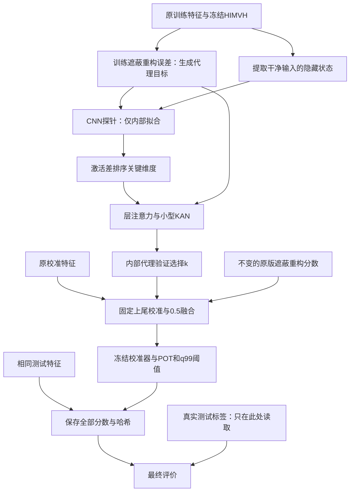

# 将隐藏边界机制融入 HIMVHAD

本扩展称为 **HIMVH-Knob-Zero**。它借鉴用户提供的《Uncovering the Knowledge Boundaries and Mechanistic “Knob” of LLMs》（Huang、Mao、Jiang、Cambria）第3节的 CNN 探针、关键维度、层注意力 KAN 和方向干预思想。论文研究语言模型答案是否正确；这里研究冻结金融交易模型的隐藏状态是否能预测自身重构困难。**两者的标签、模型和任务不同，不能把该扩展叫作原文方法或原文成绩的直接复现。**

用户提供 PDF 的 SHA256：`111bc0e78a1794323be52cd69d1e6d54d01d85db4dd88b3110cf5fd4643dc508`。标题以 PDF 正文为准，未从附件文件名推断方法。附件没有作为代码指令执行，也没有上传整篇 PDF。

## 通俗解释

原版 HIMVHAD 遮住交易的某些字段，尝试从其他字段和关系恢复它们，恢复偏差越大越可疑。新增模块进一步观察模型内部：哪些内部坐标经常对应“恢复困难”的交易？如果少数坐标能表达这种边界，就把它们提炼成一个小规则，与原分数等权组合。

这里的“恢复困难”由训练特征和冻结模型自行计算，**不是已知欺诈标签**。困难的正常交易也可能被判为可疑；模型对异常交易也可能恢复得很好。因此融合有可能提高排序，也可能引入错误，消融须保留所有下降结果。



## 与论文逐项对应

| 论文机制 | 本项目实现 | 适配边界 |
|---|---|---|
| Transformer 层×维度隐藏状态 | 冻结 HIMVH 的投影、各深度原生视图均值、最终融合状态，原检查点形状5×256 | 图网络深度不等同于37层语言模型；不同视图按共享坐标求均值是新设计 |
| 多视图 CNN，卷积核9×1、1×33、5×5，ReLU 和全局最大池化 | 相同三个方向；每支8通道，单 logit BCE | 单 logit 等价于二类 logit 差；不声称通道数或训练设置等于作者未提供的细节 |
| 正确／错误类别激活差、维度排序 | 仅在内部拟合交易上计算高／低重构误差代理类别的垂直分支激活差；沿深度取绝对值求和 | 排序从不使用真实欺诈标签或测试交易 |
| Top-k 与近最优判据 | k=1至10；内部代理验证平衡准确率距全维 CNN 不超过1个百分点，取首个满足者 | 不照搬测试集选维度；未满足时用k10并明确标为未达到近最优，而非挑测试 AP 最好的k |
| 层注意力+两隐节点 KAN | softmax 层权重；两层可学习一元线性 B 样条边函数，加线性残差；网格9点 | 独立实现的 degree1 spline KAN；不是官方 pykan 配置复刻 |
| KAN 符号蒸馏 | 从训练侧 KAN logits 拟合线性、平方、tanh、log(1+z²)解析代理；输出系数和内部验证R² | 是有误差的解析近似，不声称精确闭式等价；拟合不用欺诈标签 |
| 法向／切向／随机干预 | 对内部验证交易实施归一化探针空间的 Eq7–10 方向与层补丁恒等式检查，含正负步长；方向由可微KAN而非近似解析式提供 | 梯度范数下限0.05避免巨大扰动；一维时切向不存在。只证明探针局部敏感性，不是对完整 HIMVH 的因果激活修补，也不证明金融欺诈因果关系；不用于改变正式检测分数 |

## 零标签协议与公平比较

[冻结协议](../experiments/knob_protocol_20261123.json)在本轮新分数评价前提交。保留原发布的全部结果，不修改骨干、预处理、POT 或原评分函数。比较 BankSim、S-FFSD、CardSim 的原 cm 检查点，种子42/43/44，每组9个评分设置，共81组、162个阈值工作点。

训练代理目标为原8192目标交易的遮蔽重构误差，按字段宽度加权。把这些原训练目标随机划分80%内部拟合、20%内部验证；只用内部拟合部分确定误差50%和80%分位点。低于前者是低误差代理类，高于后者是高误差代理类，中间交易不参与分类训练。标准化、CNN、激活排序只用内部拟合行；内部验证只用于k选择。两类采样各占一半，不按真实欺诈比例或标签采样。该内部验证是训练分区内的代理目标验证，不是独立真实金融验证。

隐藏状态来自各阶段的**干净输入**。原版检测分数仍是其**遮蔽字段误差**；这两条路径有意不同。代理模块捕捉重构难度，不承担主模型损失，也不会回传梯度到主模型。沿用原始全阶段原生上下文，阶段间无边，仍然是离线检测，同阶段未来交易可能进入上下文，不是严格因果的逐笔在线模型。

设原版分数为 `b(x)=cm_tail_flat(x)`。对探针输出 `g(x)`，仅用原校准行拟合上尾变换：

```
p_g(x) = [1 + #{校准行 i: g_i >= g(x)}] / (n_cal + 1)
e_g(x) = -log p_g(x)
s_fused(x) = 0.5*b(x) + 0.5*e_g(x)
```

0.5 在评价前固定，对所有数据和种子一致，不根据测试指标调整。基线直接沿用原 `b(x)`；每个新分数用相同校准行重新拟合相同规则的 POT（q0.85、risk0.01）和 q99。工作点规则相同不代表数值阈值相同。POT 失败保留失败状态，不由另一阈值冒充。

所有9组检查点、新评分、阈值和模型先落盘并记录 SHA256，再打开本轮测试标签。数据准备可以复制已标注文件，但训练／校准标签从不解析；标签只进入最后评价。BankSim/S-FFSD 已在历史研究中多次评价，CardSim 也是之前生成的单个合成世界，**本轮均是回顾性对比，没有新的未见真实银行留出集**。本轮协议固定也无法消除研究者既往接触测试结果的事实。

## 消融如何解读

| 设置 | 问题 |
|---|---|
| baseline | 原版 cm_tail_flat，逐点分数保持不变 |
| cnn_only / cnn_fused | 全维探针单独使用或融合是否有价值？ |
| kan_only / **kan_fused** | 紧凑 KAN 单独使用或融合的效果；后者是预先指定主方法 |
| random_fused | 同样k和训练预算、单次固定随机维度；不在随机组中择优 |
| uniform_fused | 去掉可学习层注意力是否损失效果？ |
| linear_fused | 用线性边界代替 KAN，非线性是否必要？ |
| symbolic_fused | 用解析近似替代 KAN，精简规则损失多少效果？ |

报告 AP（主排序指标）、梯形PR-AUC、ROC-AUC、异常类 Precision/Recall/F1、FPR、报警比例及混淆计数。没有point adjustment，不用测试标签搜索最佳F1。按三个**原骨干种子**配对汇总均值、样本标准差和逐种子差值；三个种子不足以支持强显著性结论。附加探针和k搜索增加计算，冻结骨干对比不等于相同总训练成本。

## 复现命令

```bash
python -m pip install -e '.[test]'
python -m himvhad fetch-benchmark --root data/benchmark --datasets banksim s_ffsd cardsim
mkdir -p runs/parent-banksim42
tar -xzf experiments/knob_inputs/banksim-42.tar.gz -C runs/parent-banksim42
python -m himvhad knob-run \
  --parent runs/parent-banksim42 --data data/benchmark/banksim \
  --output runs/knob-banksim42 --device cuda
```

需要复现完整81组时，使用 `python scripts/run_knob_experiment.py full --device cuda --output runs/knob-all`。它下载并核验数据，在全部组冻结后统一评价。运行时间较长的 CPU 和所有 GPU 任务应通过用户授权的 CQ 提交。

完整输出包括 `adapter.pt`、`adapter_info.json`（维度、权重、k搜索、解析式系数与R²）、`training_proxy.npz`、校准器、逐点分数、阈值、原始指标及标签访问记录。应用已保存适配器不会再选维度、训练或调整阈值：

```bash
python -m himvhad knob-predict \
  --parent runs/parent-banksim42 --adapter runs/knob-banksim42 \
  --data data/benchmark/banksim --output runs/knob-predict
```

实验表直接使用归档的原骨干误差，确保配对基线分数不变。部署预测会重新计算原骨干误差；跨CPU/CUDA或运行库时可能有浮点微差，不承诺部署输出与历史GPU逐点文件按位一致。适配器的状态、校准器和阈值均保持冻结。

English: This is a zero-label, frozen-backbone adaptation of the supplied hidden-boundary idea. Reconstruction-error proxy targets replace factual-correctness labels. We retain the unchanged baseline, paired splits and negative outcomes. Compactness and intervention diagnostics do not establish fraud correctness or a causal financial mechanism.
