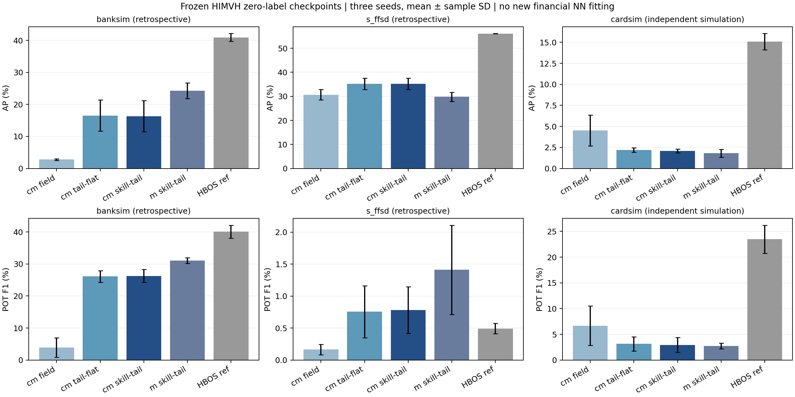

# HIMVH-Zero 冻结模型复现与评分结果

日期：2026-11-21。**本次使用18个已训练冻结模型重新计算144组评分配置／288条操作点，新金融神经网络训练次数为0。** 这验证独立包与历史模型兼容及评分复现，不冒充重新训练。模型来源：BankSim／S-FFSD的12个旧m/cm检查点，加上CQ任务j-1117-8c114e已完成的6个CardSim检查点。

原方法训练是有标签分类；本项目为零标签重构适配，不能用下面的分数复刻论文监督成绩。

## 主结果与已有评分对照

下表使用原预登记的cm-skill-tail作为固定扩展主方案，不按数据集改选最高消融。百分数，3种子均值±样本标准差。

| 数据集 | cm-field AP | cm-tail-flat AP | cm-skill-tail AP | skill相对tail-flat AP差值（百分点） | skill POT F1 | skill q99 F1 |
|---|---:|---:|---:|---:|---:|---:|
| banksim | 2.78 ± 0.23 | 16.53 ± 4.90 | 16.31 ± 4.89 | -0.22 | 26.29 ± 2.06 | 25.98 ± 1.96 |
| s_ffsd | 30.66 ± 2.14 | 35.19 ± 2.32 | 35.20 ± 2.35 | +0.01 | 0.78 ± 0.36 | 0.57 ± 0.29 |
| cardsim | 4.52 ± 1.85 | 2.20 ± 0.27 | 2.08 ± 0.21 | -0.12 | 2.95 ± 1.45 | 2.97 ± 0.94 |

BankSim／S-FFSD已被用于既有多轮分析，属于回顾性开发。CardSim模拟参数及skill公式在生成其数据前固定；这是一个独立合成世界的协议检验，**不是真实银行外部验证，也不是把旧模型直接零样本迁移**。新世界各自的训练／校准／测试分区按时间60/20/20，所有80107笔交易保留。

## 全部评分和上下文消融

### banksim／m

| 评分 | AP ↑ | ROC ↑ | POT F1 ↑ | q99 F1 ↑ | POT FPR ↓ | q99 FPR ↓ |
|---|---:|---:|---:|---:|---:|---:|
| 字段均值 | 14.02 ± 18.21 | 83.58 ± 6.94 | 16.34 ± 22.48 | 16.33 ± 22.25 | 0.98 ± 0.34 | 0.84 ± 0.30 |
| 按维数 | 22.00 ± 2.11 | 94.43 ± 1.98 | 27.27 ± 4.57 | 27.68 ± 4.45 | 0.88 ± 0.22 | 0.70 ± 0.06 |
| 字段尾证据等权 | 21.30 ± 5.00 | 95.32 ± 1.09 | 26.05 ± 2.36 | 24.75 ± 2.49 | 0.78 ± 0.12 | 0.66 ± 0.07 |
| 尾证据＋维数 | 24.88 ± 2.87 | 93.72 ± 1.10 | 30.95 ± 1.13 | 30.55 ± 1.02 | 0.68 ± 0.06 | 0.64 ± 0.04 |
| 重构增益＋尾证据（原预登记主） | 24.25 ± 2.47 | 94.38 ± 0.62 | 31.07 ± 0.89 | 30.54 ± 0.22 | 0.68 ± 0.07 | 0.64 ± 0.03 |
| 重构增益＋原误差 | 22.76 ± 1.77 | 95.64 ± 0.80 | 26.35 ± 6.00 | 26.24 ± 6.88 | 1.00 ± 0.25 | 0.71 ± 0.09 |
| 重构增益无维数先验 | 17.56 ± 2.28 | 94.87 ± 0.75 | 21.97 ± 0.89 | 20.63 ± 1.42 | 0.81 ± 0.09 | 0.70 ± 0.06 |
| 重构增益无权重下限 | 23.56 ± 2.04 | 94.71 ± 0.59 | 31.07 ± 0.82 | 30.19 ± 0.51 | 0.68 ± 0.06 | 0.64 ± 0.03 |

### banksim／cm

| 评分 | AP ↑ | ROC ↑ | POT F1 ↑ | q99 F1 ↑ | POT FPR ↓ | q99 FPR ↓ |
|---|---:|---:|---:|---:|---:|---:|
| 字段均值 | 2.78 ± 0.23 | 62.75 ± 7.30 | 3.90 ± 3.03 | 3.47 ± 2.39 | 0.96 ± 0.38 | 0.99 ± 0.08 |
| 按维数 | 14.70 ± 5.95 | 59.49 ± 7.71 | 29.28 ± 8.46 | 30.01 ± 6.42 | 0.62 ± 0.13 | 0.63 ± 0.05 |
| 字段尾证据等权 | 10.01 ± 2.03 | 69.90 ± 10.97 | 19.79 ± 3.79 | 20.97 ± 1.51 | 0.64 ± 0.18 | 0.70 ± 0.02 |
| 尾证据＋维数 | 16.53 ± 4.90 | 72.04 ± 14.03 | 26.13 ± 1.81 | 25.94 ± 1.81 | 0.79 ± 0.04 | 0.68 ± 0.05 |
| 重构增益＋尾证据（原预登记主） | 16.31 ± 4.89 | 73.75 ± 14.86 | 26.29 ± 2.06 | 25.98 ± 1.96 | 0.79 ± 0.06 | 0.67 ± 0.05 |
| 重构增益＋原误差 | 14.34 ± 5.46 | 60.28 ± 9.44 | 29.50 ± 8.65 | 30.32 ± 6.75 | 0.61 ± 0.13 | 0.63 ± 0.06 |
| 重构增益无维数先验 | 9.85 ± 2.53 | 70.69 ± 12.52 | 18.78 ± 2.86 | 20.28 ± 1.40 | 0.62 ± 0.17 | 0.70 ± 0.02 |
| 重构增益无权重下限 | 12.92 ± 9.21 | 63.31 ± 38.70 | 20.35 ± 12.22 | 20.11 ± 12.02 | 0.79 ± 0.11 | 0.74 ± 0.15 |

### s_ffsd／m

| 评分 | AP ↑ | ROC ↑ | POT F1 ↑ | q99 F1 ↑ | POT FPR ↓ | q99 FPR ↓ |
|---|---:|---:|---:|---:|---:|---:|
| 字段均值 | 29.55 ± 1.99 | 34.87 ± 6.40 | 0.19 ± 0.13 | 0.22 ± 0.13 | 1.06 ± 0.03 | 1.12 ± 0.05 |
| 按维数 | 27.65 ± 0.82 | 27.92 ± 2.74 | 0.60 ± 0.17 | 0.89 ± 0.32 | 1.18 ± 0.10 | 1.71 ± 0.15 |
| 字段尾证据等权 | 29.59 ± 0.21 | 34.80 ± 0.91 | 1.00 ± 0.36 | 1.08 ± 0.36 | 1.72 ± 0.09 | 1.84 ± 0.06 |
| 尾证据＋维数 | 29.70 ± 1.91 | 34.02 ± 5.64 | 1.41 ± 0.70 | 1.38 ± 0.66 | 2.18 ± 0.47 | 2.27 ± 0.43 |
| 重构增益＋尾证据（原预登记主） | 29.80 ± 1.93 | 34.32 ± 5.77 | 1.41 ± 0.70 | 1.49 ± 0.63 | 2.20 ± 0.50 | 2.36 ± 0.36 |
| 重构增益＋原误差 | 27.61 ± 1.11 | 27.53 ± 3.78 | 0.60 ± 0.17 | 0.94 ± 0.20 | 1.20 ± 0.08 | 1.77 ± 0.19 |
| 重构增益无维数先验 | 29.59 ± 0.77 | 34.52 ± 2.36 | 1.12 ± 0.57 | 1.15 ± 0.48 | 2.05 ± 0.31 | 2.13 ± 0.23 |
| 重构增益无权重下限 | 29.85 ± 1.94 | 34.48 ± 5.83 | 1.44 ± 0.74 | 1.49 ± 0.63 | 2.24 ± 0.56 | 2.36 ± 0.39 |

### s_ffsd／cm

| 评分 | AP ↑ | ROC ↑ | POT F1 ↑ | q99 F1 ↑ | POT FPR ↓ | q99 FPR ↓ |
|---|---:|---:|---:|---:|---:|---:|
| 字段均值 | 30.66 ± 2.14 | 38.46 ± 5.22 | 0.16 ± 0.08 | 0.19 ± 0.13 | 0.99 ± 0.08 | 0.98 ± 0.03 |
| 按维数 | 33.50 ± 1.37 | 46.32 ± 3.24 | 0.33 ± 0.21 | 0.43 ± 0.17 | 1.40 ± 0.42 | 1.48 ± 0.04 |
| 字段尾证据等权 | 32.66 ± 0.97 | 44.29 ± 2.49 | 0.62 ± 0.17 | 0.54 ± 0.20 | 1.56 ± 0.25 | 1.43 ± 0.23 |
| 尾证据＋维数 | 35.19 ± 2.32 | 49.95 ± 5.16 | 0.76 ± 0.41 | 0.52 ± 0.23 | 1.66 ± 0.16 | 1.49 ± 0.09 |
| 重构增益＋尾证据（原预登记主） | 35.20 ± 2.35 | 49.96 ± 5.23 | 0.78 ± 0.36 | 0.57 ± 0.29 | 1.70 ± 0.17 | 1.51 ± 0.11 |
| 重构增益＋原误差 | 33.99 ± 1.68 | 47.41 ± 3.88 | 0.43 ± 0.12 | 0.49 ± 0.22 | 1.57 ± 0.37 | 1.51 ± 0.11 |
| 重构增益无维数先验 | 33.46 ± 1.59 | 46.13 ± 3.89 | 0.73 ± 0.37 | 0.60 ± 0.25 | 1.71 ± 0.25 | 1.58 ± 0.18 |
| 重构增益无权重下限 | 35.20 ± 2.36 | 49.97 ± 5.26 | 0.78 ± 0.36 | 0.62 ± 0.37 | 1.72 ± 0.14 | 1.53 ± 0.08 |

### cardsim／m

| 评分 | AP ↑ | ROC ↑ | POT F1 ↑ | q99 F1 ↑ | POT FPR ↓ | q99 FPR ↓ |
|---|---:|---:|---:|---:|---:|---:|
| 字段均值 | 3.74 ± 1.13 | 78.34 ± 3.71 | 6.98 ± 1.32 | 6.12 ± 2.12 | 1.01 ± 0.03 | 0.89 ± 0.07 |
| 按维数 | 3.80 ± 1.44 | 76.95 ± 5.98 | 7.02 ± 1.99 | 6.25 ± 2.04 | 1.00 ± 0.09 | 0.93 ± 0.07 |
| 字段尾证据等权 | 3.44 ± 0.82 | 74.94 ± 3.06 | 4.71 ± 0.21 | 4.92 ± 0.19 | 0.94 ± 0.09 | 0.95 ± 0.07 |
| 尾证据＋维数 | 1.92 ± 0.53 | 57.65 ± 8.47 | 2.95 ± 0.90 | 2.93 ± 0.83 | 1.12 ± 0.08 | 1.13 ± 0.11 |
| 重构增益＋尾证据（原预登记主） | 1.80 ± 0.48 | 54.61 ± 8.28 | 2.76 ± 0.56 | 2.78 ± 0.54 | 1.12 ± 0.08 | 1.11 ± 0.10 |
| 重构增益＋原误差 | 2.88 ± 1.08 | 71.29 ± 9.84 | 2.90 ± 1.36 | 2.87 ± 1.29 | 1.04 ± 0.06 | 1.05 ± 0.05 |
| 重构增益无维数先验 | 2.04 ± 0.58 | 64.22 ± 1.48 | 3.41 ± 0.33 | 3.57 ± 0.47 | 0.97 ± 0.12 | 1.00 ± 0.08 |
| 重构增益无权重下限 | 1.63 ± 0.38 | 53.47 ± 8.19 | 2.75 ± 0.56 | 2.77 ± 0.55 | 1.13 ± 0.08 | 1.11 ± 0.09 |

### cardsim／cm

| 评分 | AP ↑ | ROC ↑ | POT F1 ↑ | q99 F1 ↑ | POT FPR ↓ | q99 FPR ↓ |
|---|---:|---:|---:|---:|---:|---:|
| 字段均值 | 4.52 ± 1.85 | 80.17 ± 4.90 | 6.68 ± 3.83 | 6.57 ± 4.20 | 0.97 ± 0.04 | 0.94 ± 0.03 |
| 按维数 | 5.25 ± 2.21 | 79.66 ± 5.50 | 6.83 ± 4.18 | 6.77 ± 4.36 | 0.97 ± 0.15 | 0.86 ± 0.10 |
| 字段尾证据等权 | 3.79 ± 0.98 | 74.22 ± 4.71 | 5.07 ± 2.04 | 5.47 ± 2.38 | 0.90 ± 0.06 | 0.97 ± 0.04 |
| 尾证据＋维数 | 2.20 ± 0.27 | 61.97 ± 5.60 | 3.15 ± 1.37 | 3.13 ± 1.40 | 1.11 ± 0.07 | 1.13 ± 0.05 |
| 重构增益＋尾证据（原预登记主） | 2.08 ± 0.21 | 58.91 ± 5.66 | 2.95 ± 1.45 | 2.97 ± 0.94 | 1.11 ± 0.06 | 1.11 ± 0.04 |
| 重构增益＋原误差 | 3.53 ± 0.96 | 74.96 ± 6.45 | 3.68 ± 2.00 | 3.70 ± 2.18 | 0.94 ± 0.06 | 1.03 ± 0.07 |
| 重构增益无维数先验 | 2.39 ± 0.67 | 61.85 ± 5.97 | 3.69 ± 2.48 | 3.90 ± 2.49 | 0.93 ± 0.05 | 1.01 ± 0.13 |
| 重构增益无权重下限 | 2.00 ± 0.24 | 57.73 ± 5.67 | 3.15 ± 1.24 | 2.96 ± 0.93 | 1.11 ± 0.06 | 1.12 ± 0.05 |

## 能说明什么，不能说明什么

**banksim：** 相对字段均值AP变化+13.53个百分点，但相对已有维数加权尾证据仅变化-0.22。本数据上的skill权重没有超过该对照，不能将尺度或维数先验收益归功于新的重构增益。

**s_ffsd：** 相对字段均值AP变化+4.53个百分点，但相对已有维数加权尾证据仅变化+0.01。本数据上存在超过同尺度宽度先验的收益，仍需结合种子差异及FPR，不自动构成显著性或广泛泛化结论。

**cardsim：** 相对字段均值AP变化-2.44个百分点，但相对已有维数加权尾证据仅变化-0.12。本数据上的skill权重没有超过该对照，不能将尺度或维数先验收益归功于新的重构增益。

可预测性与欺诈相关性不同：容易重构的字段也可能与欺诈无关，难重构字段也可能含关键异常。字段宽度先验及0.25下限都有独立消融；本报告保留退步结果，不按测试分数翻转异常方向、筛种子或改变权重。完整逐字段skill、MSE基线和权重见[weights.json](weights.json)。

## 逐行基线参考（同数据／划分，不是本仓库新训练）

BankSim／S-FFSD参考继承已核验的同协议历史结果；CardSim的9个HBOS／LOF／VAE历史运行重新核验保存分数、阈值和指标。HIMVH使用额外原生关联信息，信息预算不完全等同于逐行方法。

| 数据集 | 方法 | AP | POT F1 | q99 F1 |
|---|---|---:|---:|---:|
| banksim | hbos | 40.92 ± 1.21 | 40.11 ± 2.01 | 48.89 ± 0.60 |
| banksim | lof | 2.28 ± 0.30 | 4.23 ± 1.44 | 4.18 ± 1.42 |
| banksim | vae | 39.61 ± 0.37 | 41.61 ± 0.47 | 38.64 ± 3.96 |
| s_ffsd | hbos | 56.11 ± 0.04 | 0.49 ± 0.08 | 0.87 ± 0.59 |
| s_ffsd | lof | 32.64 ± 0.41 | 3.08 ± 4.79 | 0.00 ± 0.00 |
| s_ffsd | vae | 41.86 ± 0.29 | 1.85 ± 0.00 | 1.85 ± 0.00 |
| cardsim | hbos | 15.08 ± 0.97 | 23.47 ± 2.75 | 25.30 ± 3.39 |
| cardsim | lof | 6.10 ± 0.84 | 8.38 ± 0.86 | 9.07 ± 0.92 |
| cardsim | vae | 3.62 ± 0.08 | 2.53 ± 0.51 | 3.43 ± 2.01 |

## 数据与评价边界

训练／校准不读取真实标签；训练目标最多8192行，校准最多100000行，测试全集，种子42/43/44。未知标签-1只在最终评价排除，不按正常标签清洗源数据。m重建抽样训练视图，cm用完整原生训练上下文，但损失目标相同。每阶段独立构图，没有跨分区边；同阶段未来交易仍能作为上下文，所以是离线检测。构图键可能携带被遮蔽字段的结构信息，不能声称所有类别线索都被移除。

POT q=.85／risk=.01／min20，失败N/A，独立q99；不做point-adjust。本文F1为异常类F1，论文报告macro-F1，数值不直接比较；AP与梯形PR-AUC分开记录。校准CDF、权重和POT共用校准样本，没有有限样本误报保证；高异常占比下只看F1容易误判。

| 数据集 | 已知测试异常占比＝常数AP | 旧／独立范围 |
|---|---:|---|
| banksim | 1.08 | 旧测试回顾性 |
| s_ffsd | 38.87 | 旧测试回顾性 |
| cardsim | 0.96 | 一个独立模拟来源 |

## 核验和复现

18个模型均验证checkpoint张量加载、原采样索引、训练预处理、语义字段划分及固定CPU稀疏邻域探针；误差容差rtol5e-4/atol2e-5以覆盖原CUDA散射和CPU计算差异。全部评分使用归档的逐字段误差重新计算，独立按unique/count重建经验CDF，重算常量基线与权重，再独立重拟合POT/q99及全部指标。BankSim／S-FFSD的48组既有field/flat/tail/tail_flat结果与上一轮指标完全一致。跨设备端到端重新推理可能有微小数值差异，不能保证经验CDF分数及阈值边界报警逐位相同。

[核验记录](verification.json) · [逐种子144配置](per_seed.json) · [288条操作点](metrics.csv) · [96条汇总](summary.csv) · [配对消融](paired_effects.csv) · [历史指标一致性](historical_metric_identity.json) · [父模型哈希](parent_models.json)。原检查点来自历史CQ归档，未将训练时间说成本次耗时。

快速命令及重新训练入口见[项目README](../../README.md)。三个预训练示例统一选择cm/seed42，未按最佳种子筛选。其他种子可从原CQ归档恢复或用公开数据及本包重新训练；没有把私人归档路径写成公开可下载地址。

## Plain English

We re-evaluated144 scoring configurations on18 frozen HIMVH zero-label models and audited288 operating points, with zero new financial neural-network fits. Existing training artifacts and this new scoring run are distinguished. All prescribed ablations and negative effects are retained;the fixed skill-weight primary is not swapped by dataset. CardSim is one independently generated synthetic world,not external real-bank validation or zero-shot transfer. Paper supervised results and macro-F1 are not reproduced by this reconstruction adaptation.
