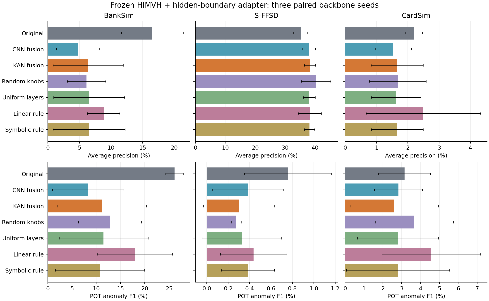

# HIMVH 隐藏边界融合与消融实验（2026-11-23）

本报告由 `scripts/build_knob_report.py` 从完成的CQ逐种子记录生成。方法是用户所附论文机制的**零标签适配**，不是论文LLM成绩或原HIMVH监督成绩的复现。主方法固定为 `kan_fused`，不按各测试集最佳消融重新命名。

[方法与复现命令](../../docs/mechanistic_boundary_CN.md) · [冻结协议](../../experiments/knob_protocol_20261123.json) · [逐种子指标](metrics.csv) · [配对差值](paired_differences.csv) · [代理诊断](proxy_diagnostics.csv)

## 原版与融合版：三个骨干种子的配对对比

数值为百分数均值 ± 样本标准差；Δ为融合版减原版的百分点。AP为主排序指标；F1用预先固定的POT/q99规则，不搜索测试集最佳阈值。

| 数据集 | 原版AP | 融合AP | ΔAP | 原版POT-F1 | 融合POT-F1 | 原版q99-F1 | 融合q99-F1 |
|---|---:|---:|---:|---:|---:|---:|---:|
| banksim | 16.53 ± 4.90 | 6.37 ± 5.54 | -10.16 ± 4.92 | 26.13 ± 1.81 | 11.12 ± 9.21 | 25.94 ± 1.81 | 11.13 ± 9.30 |
| s_ffsd | 35.19 ± 2.32 | 38.28 ± 1.88 | +3.09 ± 3.76 | 0.76 ± 0.41 | 0.30 ± 0.33 | 0.52 ± 0.23 | 0.41 ± 0.45 |
| cardsim | 2.20 ± 0.27 | 1.66 ± 0.83 | -0.54 ± 0.72 | 3.15 ± 1.37 | 2.60 ± 2.34 | 3.13 ± 1.40 | 2.64 ± 2.41 |

仓库已有 `cm_skill_tail` 扩展也保留作参考（历史同检查点／划分结果，未冒充本轮新跑）：

- banksim：原skill扩展AP 16.31 ± 4.89%；本轮主方法相对它 -9.94个百分点。
- s_ffsd：原skill扩展AP 35.20 ± 2.35%；本轮主方法相对它 +3.08个百分点。
- cardsim：原skill扩展AP 2.08 ± 0.21%；本轮主方法相对它 -0.42个百分点。

## 完整消融：平均精确率AP

| 设置 | BankSim | S-FFSD | CardSim |
|---|---:|---:|---:|
| baseline | 16.53 ± 4.90 | 35.19 ± 2.32 | 2.20 ± 0.27 |
| cnn_only | 1.52 ± 0.53 | 43.38 ± 6.88 | 1.12 ± 0.32 |
| cnn_fused | 4.77 ± 3.43 | 38.00 ± 2.09 | 1.54 ± 0.58 |
| kan_only | 2.30 ± 1.63 | 50.48 ± 7.42 | 1.30 ± 0.64 |
| kan_fused | 6.37 ± 5.54 | 38.28 ± 1.88 | 1.66 ± 0.83 |
| random_fused | 6.11 ± 3.04 | 40.35 ± 4.95 | 1.68 ± 0.90 |
| uniform_fused | 6.53 ± 5.60 | 38.07 ± 1.99 | 1.63 ± 0.79 |
| linear_fused | 8.83 ± 2.55 | 38.22 ± 3.84 | 2.50 ± 1.83 |
| symbolic_fused | 6.52 ± 5.71 | 38.15 ± 1.76 | 1.66 ± 0.83 |

`baseline`复用原cm_tail_flat误差与评分公式，同轮消融共用保存的基线分数，骨干参数不更新；`cnn_only/kan_only`去掉原版分数；`cnn_fused`不压缩到少量维度；`random_fused`替换关键维度；`uniform_fused`去掉层注意力；`linear_fused`去掉KAN非线性；`symbolic_fused`替换为解析近似。随机维度是固定单次控制，不是随机集合分布的全面检验。

## 完整消融：POT-F1 / q99-F1

| 设置 | BankSim | S-FFSD | CardSim |
|---|---:|---:|---:|
| baseline | 26.13 ± 1.81 / 25.94 ± 1.81 | 0.76 ± 0.41 / 0.52 ± 0.23 | 3.15 ± 1.37 / 3.13 ± 1.40 |
| cnn_only | 0.08 ± 0.15 / 0.08 ± 0.15 | 0.39 ± 0.39 / 0.39 ± 0.39 | 1.25 ± 0.09 / 1.06 ± 0.39 |
| cnn_fused | 8.30 ± 7.39 / 8.77 ± 7.71 | 0.38 ± 0.33 / 0.41 ± 0.38 | 2.83 ± 1.27 / 2.79 ± 1.21 |
| kan_only | 3.91 ± 5.34 / 3.92 ± 5.35 | 0.27 ± 0.33 / 0.27 ± 0.33 | 1.71 ± 1.66 / 1.73 ± 1.66 |
| kan_fused | 11.12 ± 9.21 / 11.13 ± 9.30 | 0.30 ± 0.33 / 0.41 ± 0.45 | 2.60 ± 2.34 / 2.64 ± 2.41 |
| random_fused | 12.83 ± 6.51 / 12.39 ± 5.76 | 0.27 ± 0.05 / 0.30 ± 0.05 | 3.66 ± 2.07 / 3.73 ± 2.11 |
| uniform_fused | 11.50 ± 9.18 / 11.47 ± 9.24 | 0.33 ± 0.37 / 0.49 ± 0.58 | 2.79 ± 2.15 / 2.79 ± 2.16 |
| linear_fused | 17.95 ± 7.76 / 17.91 ± 8.02 | 0.44 ± 0.31 / 0.49 ± 0.36 | 4.57 ± 2.61 / 4.76 ± 2.75 |
| symbolic_fused | 10.72 ± 9.18 / 10.75 ± 9.24 | 0.38 ± 0.25 / 0.44 ± 0.33 | 2.81 ± 2.73 / 2.82 ± 2.77 |

完整Precision、Recall、PR-AUC、ROC-AUC、FPR、报警比例和混淆矩阵在 `metrics.csv/per_seed.json`，各数值阈值及POT状态保存在 `runs/<dataset>/<seed>/<variant>/thresholds.json`。三个种子不足以宣称统计显著。

图显示原版与融合设置，误差棒为三个种子的样本标准差；仅用探针的两项消融见上表。

## 标签比例与报警工作点

| 数据集 | 已知标签测试数 | 异常标签比例 | 原版POT报警比例 | 融合POT报警比例 |
|---|---:|---:|---:|---:|
| banksim | 118638 | 1.08% | 1.06 ± 0.06% | 1.02 ± 0.03% |
| s_ffsd | 6159 | 38.87% | 1.16 ± 0.16% | 0.61 ± 0.29% |
| cardsim | 16021 | 0.96% | 1.13 ± 0.08% | 1.00 ± 0.07% |

完整打分覆盖118638 / 15576 / 16021条测试交易；S-FFSD有9417条未知标签按原规则排除，监督指标仅评价剩余6159条。表中报警比例也以已知标签行作为分母，不代表未知交易的真实欺诈比例。

校准风险1%并不保证测试报警比例恰好1%，也不是已知欺诈比例。当测试异常比例远高于实际报警比例时，即使排序尚可，固定工作点召回率和F1仍可能很低。本轮没有依据这些测试比例回调阈值。未知标签按原规则排除。

## 哪些模块实际有帮助

- **banksim**：主方法ΔAP -10.16个百分点，0/3个配对种子提升；相对全维CNN融合 +1.60，相对同k随机维度 +0.26，相对线性边界 -2.46。本次所列消融中AP最高为 `baseline`（16.53 ± 4.90%），按未舍入均值比较。它是事后描述，不替代预先指定主方法。
- **s_ffsd**：主方法ΔAP +3.09个百分点，2/3个配对种子提升；相对全维CNN融合 +0.28，相对同k随机维度 -2.07，相对线性边界 +0.06。本次所列消融中AP最高为 `kan_only`（50.48 ± 7.42%），按未舍入均值比较。它是事后描述，不替代预先指定主方法。
- **cardsim**：主方法ΔAP -0.54个百分点，0/3个配对种子提升；相对全维CNN融合 +0.12，相对同k随机维度 -0.02，相对线性边界 -0.84。本次所列消融中AP最高为 `linear_fused`（2.50 ± 1.83%），按未舍入均值比较。它是事后描述，不替代预先指定主方法。

## 紧凑性与解析近似是否成立

| 数据集 | 种子 | 维度k | 达到代理近最优判据 | CNN代理BA | KAN代理BA | 解析式验证R² |
|---|---:|---:|---|---:|---:|---:|
| banksim | 42 | 10 | 否，达到搜索上限 | 0.9093 | 0.8142 | 0.9960 |
| banksim | 43 | 10 | 否，达到搜索上限 | 0.8759 | 0.8450 | 0.9961 |
| banksim | 44 | 10 | 否，达到搜索上限 | 0.8455 | 0.7772 | 0.9965 |
| s_ffsd | 42 | 10 | 否，达到搜索上限 | 0.9176 | 0.8827 | 0.9979 |
| s_ffsd | 43 | 10 | 否，达到搜索上限 | 0.9561 | 0.8518 | 0.9977 |
| s_ffsd | 44 | 10 | 否，达到搜索上限 | 0.9351 | 0.9022 | 0.9979 |
| cardsim | 42 | 10 | 否，达到搜索上限 | 0.6898 | 0.6558 | 0.9979 |
| cardsim | 43 | 10 | 否，达到搜索上限 | 0.6498 | 0.6284 | 0.9968 |
| cardsim | 44 | 10 | 否，达到搜索上限 | 0.7308 | 0.6533 | 0.9985 |

**这些BA只是识别高／低训练重构误差的能力，不能与欺诈检测准确率混用。** 未达到近最优判据时不声称发现了近无损小子空间；低R²或负R²表示解析规则不能忠实近似KAN，仍保留其检测消融。各组维度、注意力、公式系数和完整k搜索记录可查 `adapter_info.json`。

## 本轮结果直接支持什么

- **紧凑判据未实现**：9/9组在k≤10内未达到全维CNN代理BA减1个百分点的标准，均触及预设上限。本次只能报告候选维度，不能声称发现了论文意义上的近无损“旋钮”。
- **重构难度与欺诈标签不等价**：BankSim的CNN代理BA为0.85–0.91，但CNN单独检测AP只有1.52%，明显低于原版16.53%。这个差距直接说明代理任务学得好，仍可能没有识别真实异常的能力。
- **统一融合可能损失有用排序**：S-FFSD上KAN单独AP为50.48%，固定0.5融合后为38.28%。本轮按冻结协议保留融合版为主方法，没有事后把最佳消融改名。
- **维度选择与非线性尚未得到稳定支持**：S-FFSD的随机维度融合AP高于主方法；CardSim两者接近；BankSim和CardSim的线性融合均高于KAN融合。均匀层权重与学习层权重的差异也较小，不能据此宣称新的潜在几何具有普遍优势。
- **解析近似不是当前主要损失点**：内部验证R²为0.9960–0.9985，解析版与KAN融合版的平均AP差距最多0.15个百分点。当前证据不支持把整体下降主要归因于解析表达式失真。
- **排序改进不等于阈值工作点改善**：S-FFSD的AP提高，但POT-F1下降；已知标签测试行中异常占38.87%，主方法POT报警约0.61%，Precision仅7.93%、Recall仅0.153%。低报警率限制召回，报警精确率也下降，不能只把问题归因于阈值。没有用这一观察回调阈值。

## 如何解释提升与下降

以下是结合任务差异和消融的解释，属于机制推断，不是已证实的金融因果结论：

- 代理目标只反映模型重构困难，可能集中在罕见正常交易、字段尺度或关系稀疏性。真实欺诈可以被模型重构得很好；因此高代理BA并不保证高欺诈AP。
- 冻结骨干没有因新模块学到新的反欺诈信息。新模块主要重新组织已有状态；如果CNN单独或KAN单独明显弱于基线，融合只会把噪声加入原分数。
- 若完整KAN不优于同k随机维度或线性控制，本次证据不支持“选出的关键维度／KAN非线性是收益来源”。少量图网络深度也不同于原文深层语言模型，不能借用其机制结论。
- 原版的字段校准有时已携带较强信息。统一0.5融合可能稀释它；权重固定是为了避免用本轮测试标签补救结果。
- AP与固定阈值F1可能相反：AP评价全部排序，POT/q99只看一个校准工作点；校准与测试分布变化会改变报警率。不能只保留其中改善的指标。
- 解析式的R²低表示蒸馏损失；探针法向能改变自身logit是局部数学性质，不代表改善真实欺诈识别。
- 本轮只用固定200步CNN和150步学生预算，没有收敛曲线、多预算或更大探针的对照。因此可能存在训练预算／图隐藏空间适配不足，不能把下降直接归因于原论文思想无效。

## 公平性与证据边界

三个数据集原始划分、目标行、测试样本、训练缩放器和骨干检查点不变。新增模块只用训练特征和自身重构误差；内部验证只在原训练分区。校准用于分数尾部与阈值。所有9组评分及阈值在本轮第一次打开测试标签前冻结；`global_label_gate.json`及各组记录提供SHA链。基线误差直接取已核验历史文件，防止跨CPU/CUDA重算微差混入方法改进。

BankSim和S-FFSD是回顾性测试；CardSim是此前生成的单个合成世界，本次并未新增独立真实数据。附加探针、k搜索和对照有额外计算成本。方向干预只在内部验证的标准化探针状态做诊断，未声称对完整骨干做因果干预。

完成9组冻结骨干、81个评分配置；新增骨干训练0次。完整实验耗时29.67分钟，单进程峰值RAM3.24GiB，峰值CUDA分配：不使用GPU（CPU运行）。CQ作业记录固定源码提交，`runtime.json`记录各源码文件SHA与环境；Kaggle快照没有.git时其Git字段为null，通过源码SHA独立核验。时长不含CQ排队、环境作业与后端检查。

该耗时针对冻结检查点扩展实验，包含本轮训练代理误差、隐藏状态提取和新增头训练。历史基线误差作为缓存输入，其最初计算成本、原骨干训练成本未计入；这不是端到端从零训练成本或在线逐笔预测延迟。

## 产物与重新运行

本目录发布全部逐种子指标、差值、阈值、代理搜索记录和SHA。固定seed42的三个适配器及校准器也保留在 `runs/<dataset>/42/`，不是按最佳种子挑选。全部逐点分数、训练代理误差及其余种子模型保留在本轮CQ完整结果归档；其SHA在标签访问记录中，重现命令见方法说明。

English: Nine paired frozen-backbone runs evaluate a CNN/KAN hidden-boundary adaptation with training reconstruction-error proxy targets. The unchanged baseline, all ablations and negative outcomes are retained. Proxy compactness and directional sensitivity do not demonstrate fraud correctness, statistical significance or a causal financial mechanism.

## 初跑保留与随机流修正

初跑j-1123-21f2ed的完整指标保存在[pilot记录](pilot_rng/per_seed.json)。静态复核发现，初版的三个模块对照用了不同初始化和小批次流；修正版统一为选定KAN的随机流，新增测试核验同形参数初值逐项相等。修正发生在查看任何新金融测试指标之前，未根据结果选参数。

初跑没有删去，也不纳入主表均值。下表仅说明实现修正的影响，不能把初跑当作额外独立种子或新数据。

| 数据集 | 对照 | 初跑AP | 对齐随机流后AP | 差值/百分点 |
|---|---|---:|---:|---:|
| banksim | random_fused | 4.88 | 6.11 | +1.23 |
| banksim | uniform_fused | 8.15 | 6.53 | -1.62 |
| banksim | linear_fused | 3.25 | 8.83 | +5.58 |
| s_ffsd | random_fused | 36.58 | 40.35 | +3.77 |
| s_ffsd | uniform_fused | 38.94 | 38.07 | -0.86 |
| s_ffsd | linear_fused | 40.38 | 38.22 | -2.17 |
| cardsim | random_fused | 1.48 | 1.68 | +0.20 |
| cardsim | uniform_fused | 1.99 | 1.63 | -0.36 |
| cardsim | linear_fused | 2.91 | 2.50 | -0.41 |

原版、CNN、主KAN和解析近似路径的公式未改变；两个独立运行中，54/54条路径的校准与测试分数按位相同。其余差异（若存在）在[逐路径检查](pilot_rng/unchanged_path_parity.csv)中披露，不冒充随机流修正带来的方法增益。

## 独立核验与部署检查

全部81组评分、162个阈值工作点完成独立回放，9组历史基线指标完全一致；原始误差文件及评分前SHA链均核验。本机与云端重新计算同一基线的最大浮点末位差为8.88e-16，按1e-12数值容差核验，不宣称跨平台逐点按位相同。原始失败的严格按位检查与修订原因保存在任务记录中，未修改任何模型分数或阈值以通过检查。详见[核验JSON](verification.json)。

CardSim固定seed42模型完成16021行、9个设置的本机端到端预测，真实标签访问被拦截。相比CQ归档，主KAN融合分数最大差0.001546；两种阈值下9个设置的报警差异均为0。该检查涉及本机Torch2.6、云端Torch2.11与历史GPU误差，数值差异已保留，未承诺所有环境/数据都按位一致。详见[部署记录](pretrained_prediction_verification.json)。

35项本地与CQ远端测试通过；独立wheel安装、适配器训练/保存/重载和源码一致性检查通过。完整CQ产物可用 `cq fetch j-1123-c26354` 取得；初跑为 `cq fetch j-1123-21f2ed`。

English: The primary fusion improves AP on S-FFSD but reduces AP on BankSim and CardSim, and reduces POT-F1 on all three datasets. None of the nine searches meets the compactness criterion. High symbolic fidelity does not translate into reliable fraud detection gains. No test-label tuning or default-method replacement follows these outcomes.
